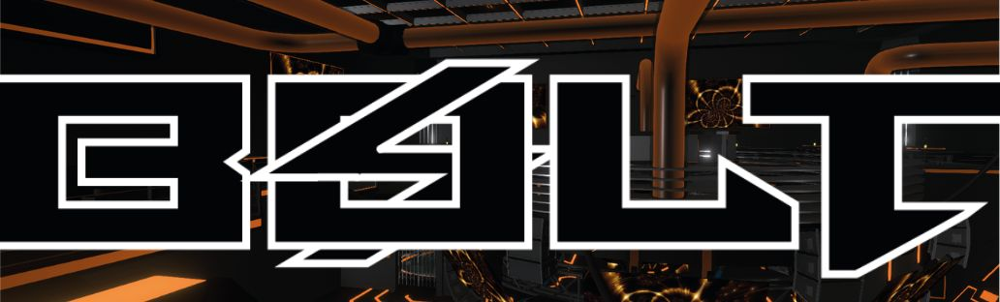

<div align="center">
  

  # ⚡ Chainvas
  ### *The decentralized nexus for collaborative creation.*

  [](https://github.com/BOLTEVM/Chainvas/stargazers)
  [](https://github.com/BOLTEVM/Chainvas)
  [](https://github.com/BOLTEVM)
  [](https://opensource.org/licenses/MIT)

  [**Explore Features**](#-key-capabilities) • [**Tech Stack**](#-powered-by) • [**Quick Start**](#-getting-started) • [**Contribute**](#-contribution)
</div>

<br />

---

## 🎨 Overview

**Chainvas** is a high-performance, multi-modal collaborative suite built for the modern decentralized web. It bridges the gap between traditional creative tools and blockchain-backed permanence, allowing teams to create, sync, and mint digital assets in real-time.

> [!IMPORTANT]
> This project is currently in **Active Development**. High-fidelity collaboration and EVM-native asset management are the core pillars of our ecosystem.

<br />

## 🚀 Key Capabilities

| Feature | Description | Status |
| :--- | :--- | :--- |
| **🖼️ Photo Engine** | High-performance canvas editing with layers, filters, and P2P sync. | `STABLE` |
| **📝 Text Nexus** | Real-time collaborative document editing with conflict resolution. | `BETA` |
| **⛓️ On-Chain Assets** | native Hardhat integration for seamless NFT minting and metadata. | `STABLE` |
| **📡 P2P Sync** | Zero-latency collaboration using Y.js and WebRTC. | `STABLE` |
| **☁️ Cloud DB** | Relational data persistence powered by SpacetimeDB. | `INTEGRATED` |

<br />

## 🛠️ Powered By

<details open>
<summary><b>Frontend Architecture</b></summary>
Constructed with <b>Next.js 16</b> and <b>React 19</b>, utilizing the latest <b>React Compiler</b> for optimal performance. Fully responsive UI styled with <b>Tailwind CSS 4</b>.
</details>

<details open>
<summary><b>Decentralized Backend</b></summary>
Leveraging <b>SpacetimeDB</b> for on-chain relational logic and <b>Y.js</b> for state-based collaboration over <b>WebRTC</b> and <b>WebSocket</b> protocols.
</details>

<details open>
<summary><b>Smart Contract Suite</b></summary>
A robust <b>Hardhat</b> environment manages <b>Solidity 0.8.26</b> contracts, utilizing <b>Ethers.js v6</b> for seamless blockchain interactions.
</details>

<br />

## 🚦 Getting Started

### 📦 Installation

Ensure you have **Node.js 20+** and **pnpm 10+** installed.

```bash
# Clone the repository
git clone https://github.com/BOLTEVM/Chainvas.git

# Enter the workspace
cd Chainvas

# Install dependencies (highly optimized via pnpm)
pnpm install
```

### 💻 Local Development

```bash
# Spin up the Next.js dev server
pnpm run dev

# Run smart contract tests
pnpm exec hardhat test
```

<br />

## 📜 Roadmap

- [x] **Phase 1**: Initial migration to `pnpm` and monorepo stabilization.
- [x] **Phase 2**: Multi-compiler support for Solidity 0.8.26 and OZ v5.
- [ ] **Phase 3**: Integration of advanced WebRTC signaling for global low-latency sync.
- [ ] **Phase 4**: Expansion of the Photo Engine with AI-driven generative tools.

<br />

---

<div align="center">
  <p>Built with ⚡ and ❤️ by the <b>BOLT Team</b></p>
  <sub>Copyright © 2026 BOLT Chainvas. All rights reserved.</sub>
</div>